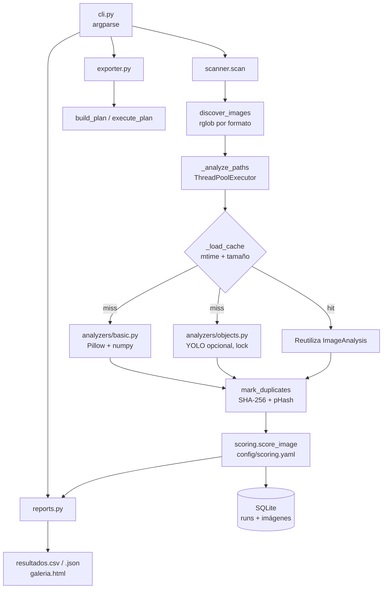

# pics-identifier — FotoTriage CLI

FotoTriage analiza una ruta de imágenes y asigna un score explicable de 0 a 100. El objetivo es separar fotografías potencialmente importantes de capturas, imágenes defectuosas, duplicados y basura probable sin depender de servicios externos.

[](https://python.org)
[](https://github.com/bi0punk/pics-identifier/actions/workflows/ci.yml)

## Contenido

- [Características](#características)
- [Arquitectura](#arquitectura)
- [Stack](#stack)
- [Estructura del repositorio](#estructura-del-repositorio)
- [Instalación](#instalación)
- [Uso](#uso)
- [Configuración](#configuración)
- [Tests / CI](#tests--ci)
- [Roadmap](#roadmap)
- [Licencia](#licencia)

## Características

- Score explicable de 0 a 100 combinando calidad, metadatos, contenido, originalidad y penalizaciones.
- Análisis local, sin servicios externos ni envío de imágenes.
- Segmentación por decisiones: `important`, `useful`, `review`, `trash_candidate`, `corrupt`.
- Detección de duplicados exactos (SHA-256) y perceptivos (hash + relación de aspecto).
- Perfiles de análisis `fast`, `balanced` y `deep`.
- Detección opcional de objetos con YOLO en CPU (`ultralytics`).
- Soporte opcional HEIC/HEIF (`pillow-heif`).
- Reportes en CSV, JSON y galería HTML offline.
- Historial de ejecuciones y explicaciones en SQLite.
- Reanálisis incremental: reutiliza resultados no modificados comparando `mtime` y tamaño.
- Exportación (`copy`/`move`) con simulación por defecto; solo ejecuta con `--apply`.

## Arquitectura



## Stack

| Componente | Tecnología |
|---|---|
| Lenguaje | Python >= 3.10 |
| Procesamiento de imagen | Pillow >= 10, numpy >= 1.24 |
| Configuración | PyYAML >= 6.0 |
| Detección de objetos (opcional) | ultralytics >= 8.3 |
| HEIC/HEIF (opcional) | pillow-heif >= 0.18 |
| Persistencia | SQLite |
| Tests / lint | pytest >= 8, ruff >= 0.6 |
| Empaquetado | setuptools + pyproject.toml |

## Estructura del repositorio

```
pics-identifier/
├── config/
│   └── scoring.yaml            # Umbrales, pesos y penalizaciones
├── fototriage/
│   ├── cli.py                  # Punto de entrada (subcomandos)
│   ├── scanner.py              # Descubrimiento, análisis paralelo, caché, duplicados
│   ├── scoring.py              # Cálculo del score
│   ├── database.py             # Historial SQLite
│   ├── exporter.py             # Plan de copia/movimiento
│   ├── reports.py              # CSV, JSON y galería HTML
│   ├── config.py               # Carga de configuración
│   ├── models.py               # ImageAnalysis / Detection
│   └── analyzers/
│       ├── basic.py            # Análisis técnico y metadatos
│       └── objects.py          # Detector YOLO opcional
├── scripts/
│   └── smoke_test.py           # Prueba end-to-end
├── tests/                      # Suites pytest
├── .github/workflows/ci.yml    # CI
├── install.sh                  # Instalación en Linux (venv)
├── pyproject.toml
├── requirements.txt
├── requirements-objects.txt
└── spec.md
```

## Instalación

Instalación en Linux con entorno virtual:

```bash
chmod +x install.sh
./install.sh
source .venv/bin/activate
```

Para agregar detección de personas, animales y objetos:

```bash
pip install -e '.[objects]'
```

El primer uso del perfil `balanced` puede descargar el modelo configurado. El modo `fast` no necesita YOLO.

## Uso

```bash
# Análisis liviano, completamente local
fototriage scan ~/Fotos \
  --profile fast \
  --db ./fototriage.sqlite3 \
  --report ./reportes

# Análisis con detección de objetos en CPU
fototriage scan ~/Fotos \
  --profile balanced \
  --model yolo11n.pt \
  --db ./fototriage.sqlite3 \
  --report ./reportes

# Controlar la cantidad de hilos de análisis (por defecto usa todos los núcleos)
fototriage scan ~/Fotos --profile fast --db ./fototriage.sqlite3 --workers 4

# Abrir/crear galería
fototriage gallery --db ./fototriage.sqlite3 --open

# Explicar una imagen
fototriage explain ~/Fotos/IMG_001.jpg --db ./fototriage.sqlite3

# Simular copia de importantes y dudosas
fototriage export \
  --db ./fototriage.sqlite3 \
  --output ./clasificadas \
  --decision important \
  --decision review \
  --mode copy

# Ejecutar la copia una vez revisado el plan
fototriage export \
  --db ./fototriage.sqlite3 \
  --output ./clasificadas \
  --decision important \
  --decision review \
  --mode copy \
  --apply
```

### Perfiles

| Perfil | Análisis técnico | Duplicados | Objetos YOLO | Semántica/OCR |
|---|---:|---:|---:|---:|
| `fast` | Sí | Sí | No | No |
| `balanced` | Sí | Sí | Sí, si está instalado | No |
| `deep` | Sí | Sí | Sí, si está instalado | Preparado para fase 2 |

Si YOLO no está instalado, `balanced` continúa con el análisis básico y muestra una advertencia.

### Resultados

`--report` genera:

- `resultados.csv`: revisión y filtrado en planilla.
- `resultados.json`: salida completa para integraciones.
- `galeria.html`: galería offline con filtros.
- `fototriage.sqlite3`: historial de ejecuciones y explicaciones.

## Configuración

El score combina calidad (nitidez, exposición, resolución), metadatos (EXIF, cámara, fecha, GPS), contenido (objetos detectados), originalidad (penalización de duplicados) y penalizaciones (captura probable, desenfoque, baja resolución, imagen casi uniforme).

Todos los umbrales, pesos y penalizaciones están en `config/scoring.yaml`. Conviene calibrarlos con una muestra de fotos reales antes de usar `trash_candidate` para tomar decisiones.

### Seguridad por defecto

- No modifica ni elimina originales durante `scan`.
- `export` simula la operación salvo que se entregue `--apply`.
- La opción recomendada es `--mode copy`.
- Las decisiones, componentes y motivos quedan registrados en SQLite y JSON.

## Tests / CI

```bash
pip install -e '.[dev]'
pytest -q
```

También se puede ejecutar una prueba end-to-end sin pytest:

```bash
python3 scripts/smoke_test.py
```

El workflow `.github/workflows/ci.yml` ejecuta en Python 3.10, 3.11 y 3.12: `ruff check .`, `pytest` y el smoke test end-to-end.

## Roadmap

- [x] Análisis técnico, metadatos y duplicados (`fast`)
- [x] Detección de objetos con YOLO (`balanced`) y caché incremental
- [x] Reportes CSV/JSON/galería y exportación segura en dos pasos
- [ ] Semántica y OCR reales en el perfil `deep` (CLIP/OCR)
- [ ] Calibración de pesos con muestras reales

## Licencia

Sin archivo LICENSE declarado en el repositorio.
